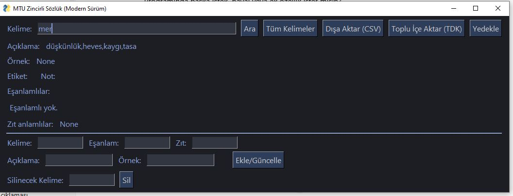

# MTU Zincirli Sözlük

Türkçe eş anlamlılar sözlüğü. Bir kelimenin eş anlamlılarını zincir gibi takip edip keşfetmenizi sağlar. TDK'dan veri çekebilir.



İki sürümü vardır: **masaüstü** (PySimpleGUI) ve **web** (Flask).

## İndir (Python gerekmez)
[**Releases**](../../releases/latest) sayfasından `MTU-Zincirli-Sozluk-Portable.exe` dosyasını indirip çift tıklayın.

> Windows SmartScreen uyarı verirse **Ek bilgi → Yine de çalıştır** deyin.

## Özellikler
- Kelime arama, eş ve zıt anlamlar
- Eş anlam zincirini ağaç ve grafik olarak gösterme
- TDK'dan veri çekme, CSV içe/dışa aktarma, yedekleme
- Favoriler

## Kaynaktan çalıştırma
Masaüstü sürümü:
```
pip install PySimpleGUI requests networkx matplotlib nltk
python sozluk_sade.py
```
Web sürümü (http://localhost:5000):
```
pip install -r requirements.txt
python web_app.py
```

Veritabanı `sozluk.db` dosyasındadır. Ayarlar `config.json` içindedir (`db_path`, `theme`, `font`, `esanlamli_buton_sayisi`).

## Web API
- `GET /api/ara?q={kelime}`: arama
- `GET /api/kelime/{kelime}`: kelime detayı
- `GET /api/zincir/{kelime}`: eş anlam zinciri
- `GET /api/istatistikler`: istatistikler

## Lisans
MIT
